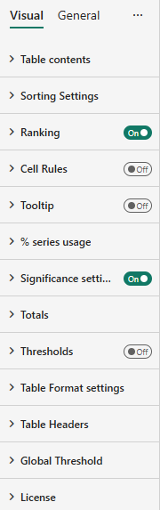
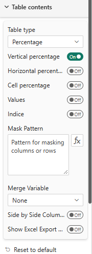

<span style={{color: '#ffffff', backgroundColor: '#ffffff'}}>Socio Data Management - All rights reserved</span>


# Explore Table Features - Detailed Walkthrough

## Overview

SDM Xtended Table offers extensive customization options organized into logical sections in the Format panel. This guide walks you through each feature section, explaining what it does and where to learn more.

The Format pane shows the cards in this order: **Table contents**, **Sorting Settings**, **Ranking**, **Cell Rules**, **Tooltip**, **% series usage** (percentage tables) or **Mean series usage** (mean tables), **Significance settings**, **Totals**, **Thresholds**, **Table Format settings**, **Table Headers**, **Global Threshold** and **License**.



---

## 1. Table Contents


**What it controls**: The fundamental data display and aggregation settings

This section determines:
- Table type (Percentage vs Mean)
- Which metrics to display (values, vertical / horizontal / cell percentages, indices)
- Data masking patterns
- Column merging (Merge Variable / Merge Formula) and Side by Side Columns
- The Excel export button

**Key decisions here**:
- Choose between percentage analysis or mean analysis
- Toggle vertical/horizontal/cell percentages
- Enable indice calculations
- Set up masking patterns for sensitive data

**When to use**: Configure this section first, as it defines what your table displays and how data is aggregated.

📖 **Learn more**: [Table Contents Reference](../04-reference/table-content.md)

---

## 2. Sorting Settings

**What it controls**: How rows and columns are arranged in your table

This section allows you to:
- Sort rows alphabetically or by column values
- Specify sorting direction (ascending/descending)
- Pin specific rows/columns to first or last positions
- Choose which metric to sort by (value, percentage, indice)

**Key decisions here**:
- Alphabetical sorting for consistency
- Value-based sorting for insights (highest sales first)
- Fixed positioning for totals and special categories

**When to use**: After your data is displaying correctly, configure sorting to highlight insights or maintain consistent presentation.

📖 **Learn more**: [Sorting & Ordering Reference](../04-reference/sorting.md)

---

## 3. Ranking Settings

**What it controls**: Visual highlighting of top/bottom performers

This composite section includes:
- **Basic Settings**: Ranking scope, order, and display method
- **Custom Colors**: Define your own color gradients
- **Exclude Range**: Prevent middle values from being colored

**Key decisions here**:
- Choose ranking scope (global, per row, per column)
- Select display format (numbered badges or color gradients)
- Configure color intensity and schemes

**When to use**: Add ranking after basic table setup to visually emphasize performance differences.

📖 **Learn more**: [Ranking & Visualization Reference](../04-reference/ranking.md)

---

## 4. Cell Rules

**What it controls**: Conditional decoration of individual cells (color, label, badge, or full CSS) driven by rules you write directly in the visual

This section allows you to:
- Write `condition : output` rules, evaluated top-to-bottom on each cell — the first matching rule wins
- React to the cell's own computed values (`pctV`, `pctH`, `cellPct`, `indice`, `value`, `base`, `avg`, `signif1`, `signif2`, `signif3`) and to header labels (`colN`, `rowN` for **any** level N)
- Color backgrounds or text, prepend labels, add colored badges, or apply full custom CSS (gradients, bold, alignment…)
- Add a `default` catch-all for cells no other rule matches

**Key decisions here**:
- Choose the display mode (cell background, text color, label, badge, or Custom CSS)
- Write conditions with numeric and header variables (remember `pctV`/`pctH` are fractions 0–1)
- Pick a badge shape when using badge mode

**When to use**: When you need conditional formatting that reacts to the numbers the visual actually displays — no DAX measure required.

📖 **Learn more**: [Cell Rules Reference](../04-reference/cell-rules.md)

---

## 5. Tooltip

**What it controls**: A native Power BI tooltip on each data cell, showing figures the table computes but does not necessarily display

Activate it with **Activate Tooltip** (off by default), then choose in the **Tooltip content** group what to show: row and column levels, value, vertical / horizontal / cell %, index, weighted and unweighted base, compared base, tested & compared values and the significance confidence level.

📖 **Learn more**: [Cell Tooltip Reference](../04-reference/tooltip.md)

---

## 6. % Series Usage

**What it controls**: Data series mapping for percentage tables

This section appears when **Table Type** is set to "Percentage" and manages:
- Value series (the counts to display)
- Base series (denominators for percentages)
- Unweighted base series
- Significance testing series
- Effective base series

**Key decisions here**:
- Map your data measures to appropriate series
- Configure weighted vs unweighted bases
- Set up series for statistical testing

**When to use**: Essential for percentage tables with custom measures or weighted data.

:::info
There is no *Multiple answer* toggle here: how group bases are built is now a **per-level** property, *Sample across items*. See [Sample Across Items](../04-reference/sample-across-items.md).
:::

📖 **Learn more**: [Percentage Series Configuration](../04-reference/percentage-series.md)

---

## 7. Mean Series Usage

**What it controls**: Data series mapping for mean tables

This section appears when **Table Type** is set to "Mean" and manages:
- Mean series (the averages to display)
- Count series (sample sizes)
- Standard deviation series
- Significance testing series for means
- Unweighted base series

**Key decisions here**:
- Map your numerical measures
- Include sample size information
- Configure standard deviation for statistical analysis

**When to use**: Essential for mean tables to properly aggregate and display average values.

📖 **Learn more**: [Mean Series Configuration](../04-reference/mean-series.md)

---

## 8. Significance Settings

**What it controls**: Statistical testing and difference highlighting

This composite section (switched on by **Activate significance tests**, on by default) includes:
- **Base settings**: Significance Level, variance method, and the type of **Significance 1 / 2 / 3**
- **Per-test groups** (one per active test, each titled "Significance"): display option, regex, custom icons
- **Significance colors**: background colors and gradients of significant cells
- **Legend**: an automatic legend below the table

**Key decisions here**:
- Choose test type (all columns, item vs other question item, item versus total, regular expression, previous visible column, previous row)
- Set confidence level (90%, 95%, 99%)
- Select visual display method (icon, font color, background color, cell border color)

**When to use**: When you need to highlight statistically significant differences between groups.

📖 **Learn more**: [Significance Testing Reference](../04-reference/significance.md)

---

## 9. Totals

**What it controls**: Display of total rows, base rows, and subtotals

This section manages:
- Total column display
- Base row configuration
- Unweighted base row
- Subtotals for hierarchical levels (chosen **per column level** from the Column editor)
- Base row positioning (top/bottom)
- Custom labels for special rows

**Key decisions here**:
- Show/hide totals and bases
- Position base rows at top or bottom
- Customize row labels
- Configure subtotals for multi-level tables — off by default, switched on level by level

**When to use**: Configure after basic table setup to add context rows.

📖 **Learn more**: [Totals & Subtotals Reference](../04-reference/totals.md)

---

## 10. Thresholds

**What it controls**: Data quality warnings and value masking

This section allows you to:
- Set warning thresholds (visual alerts)
- Set masking thresholds (hide values)
- Choose threshold basis (cell value, base, unweighted base)
- Configure empty cell display for zero values

**Key decisions here**:
- Warning level for small sample sizes
- Masking level for data protection
- What to base thresholds on

**When to use**: Important for survey data or any analysis with variable sample sizes.

📖 **Learn more**: [Thresholds & Masking Reference](../04-reference/thresholds.md)

---

## 11. Table Format Settings

**What it controls**: Visual appearance and styling

This composite section includes multiple cards:

### Table options group
- Hover highlighting
- Zebra rows
- Table border
- Selection (Enable Selection)
- Percentage symbol display
- Decimal precision
- Freeze panes and forbid horizontal scroll
- Row title width
- Column header visibility

### Style Settings group
- Pre-defined style themes (Custom, Modern, Classic, Scientific, Market Research)
- Cell text size
- Color themes (20+ options)
- Row title text alignment
- Transparent background (and Include headers)

### Tile mode and Cell format groups
- **Tile mode**: Cells rendered as separated tiles
- **Cell format**: Data cell appearance

**Key decisions here**:
- Choose a theme or create custom styling
- Set freeze panes for navigation
- Configure fonts and colors for branding
- Adjust decimal precision for your audience

**When to use**: Configure styling after data and structure are finalized, or apply pre-defined themes immediately for quick professional appearance.

📖 **Learn more**: [Formatting & Styling Reference](../04-reference/formating/index.md)

---

## 12. Table Headers

**What it controls**: The presentation of column and row headers, **level by level**

This card replaces the Top level / Sub level / Row header format cards and the Logo Lv1–Lv3 / Row Logo Lv1–Lv2 roles of CrossTable. It holds three JSON fields edited through three icons shown at the top-right of the visual in Edit view: the **Column editor** (🏛️), the **Row editor** (📝) and the **Header Logos** lookup (🖼️). For each level, with no ceiling on the number of levels, you can set:
- Font, color and background, and an additional CSS field
- Whether the level is shown, and whether it gets a sub-total (columns)
- The *Logo series* (an *Additional Series* measure returning a base64 image) and the logo placement and size
- For rows: side column or full-width band, and the width of the title column
- The size of the data columns and rows (auto, equal, minimal or fixed), the gap before each group, and how long column titles are cut

**Key decisions here**:
- Provide logos through a measure (*Logo series*) or, when they only depend on the label, through the **Header Logos** lookup (no query cost)
- Decide for each row level between a side column and a full-width band

**When to use**: To style and brand the hierarchy once data and structure are finalized.

📖 **Learn more**: [Table Headers Reference](../04-reference/table-headers.md) · [Logos in Headers](../04-reference/logos.md) · [Tutorial: Header Logos](../04-reference/tutorial-header-logos.md)

---

## 13. Global Threshold

**What it controls**: What the visual shows instead of the table when the dataset is empty, or when a test of your own is met (e.g. a base below 30)

📖 **Learn more**: [Global Threshold Reference](../04-reference/global-threshold.md)

---

## 14. License

Holds the **License Key** that unlocks the Pro edition (Excel export, no watermark). See [Editions](../01-introduction/editions.md).

---

## 15. Sample Across Items

**What it controls**: How the base of a group (total, sub-total, comparison complement) is built from the items it contains

It is a property of each header level, set in the **Sub-total** section of the Column editor (🏛️) and Row editor (📝): **Disjoint** (the items are different people, bases add up), **Shared** (the items are answered by the same sample, bases do not add up) or **Native** (the sub-total is read from your own DAX measure).

📖 **Learn more**: [Sample Across Items](../04-reference/sample-across-items.md)

---

## Typical Configuration Workflow

Here's a recommended order for configuring your table:

### Phase 1: Foundation (Required)
1. **Table Contents**: Choose table type, select what to display
2. **Series Configuration**: Map your data (% or Mean series)
3. **Totals**: Add base rows and total columns
4. **Sample across items**: Declare, per level, whether items share the same sample

### Phase 2: Analysis (Optional)
5. **Sorting**: Arrange for insights or consistency
6. **Significance**: Highlight statistical differences
7. **Ranking**: Visual performance indicators
8. **Thresholds**: Data quality controls

### Phase 3: Presentation (Final)
9. **Table Headers**: Format each header level, add logos
10. **Table Format**: Apply styling and themes
11. **Fine-tune**: Adjust fonts, colors, precision

---

## Feature Dependencies

Some features depend on others:

| Feature | Requires |
|---------|----------|
| **Vertical %** | Base series configured |
| **Significance Testing** | Significance series configured |
| **Ranking** | Ranking enabled |
| **Indice** | Value and base series |
| **Threshold Masking** | Threshold enabled |
| **Header logos** | A *Logo series* measure in Additional Series, or a Header Logos lookup |

---

## Quick Reference: What Each Section Does

| Section | Primary Purpose | When to Configure |
|---------|----------------|-------------------|
| **Table Contents** | Define data type and display | First |
| **Sorting** | Arrange rows/columns | After data displays |
| **Ranking** | Visual highlights | After basic setup |
| **Cell Rules** | Conditional cell decoration | After values display |
| **Tooltip** | Hidden figures on hover | Any time |
| **% Series** | Map percentage data | With Table Contents |
| **Mean Series** | Map mean data | With Table Contents |
| **Significance** | Statistical testing | After analysis decisions |
| **Totals** | Context rows | After basic setup |
| **Thresholds** | Data quality | After totals |
| **Table Format** | Visual styling | Last (or use themes first) |
| **Table Headers** | Per-level header style, logos | With Table Format |
| **Global Threshold** | Empty dataset / unpublishable data panel | Last |

---

## Common Configuration Scenarios

### Scenario 1: Simple Survey Report
```
1. Table Contents: Percentage table, vertical %
2. Totals: Show total column, base row
3. Table Format: Apply "Market Research" theme
→ Done!
```

### Scenario 2: Performance Analysis with Ranking
```
1. Table Contents: Percentage table, vertical %
2. Sorting: Sort by "Total" column, descending
3. Ranking: Enable ranking, color gradient
4. Totals: Total column, base row at top
5. Table Format: "Modern" theme
→ Highlights top performers automatically
```

### Scenario 3: Statistical Comparison
```
1. Table Contents: Percentage, vertical % + horizontal %
2. % Series: Configure all series including significance
3. Significance: Test 1 = All columns, Test 2 = Item vs other question item
4. Totals: Base row, signif base row
5. Threshold: Warn below n=50
6. Table Format: Custom styling for brand
→ Full statistical analysis table
```

### Scenario 4: Deep hierarchy with branded headers
```
1. Rows: Country > Brand ; Columns: Wave > Age band > Gender
2. Table Headers: format each level, logos on Brand
3. Sample across items: "Shared" on the Brand level
4. Totals: sub-totals shown on Wave and Age band
→ Four-level table with consistent totals
```

---

## Next Steps

Now that you understand what each section does:

1. **Start Simple**: Configure Table Contents and Totals first
2. **Add Analysis**: Try Sorting or Ranking
3. **Go Advanced**: Explore Significance and Thresholds
4. **Polish**: Apply themes or customize header formatting

📖 **Reference Guides**: Explore detailed settings for each section using the links above

🎯 **Use Cases**: See real-world examples in [Business Cases](../03-use-cases/business-cases.md)

❓ **Need Help?**: Start with the [Quick Start Guide](./quick-start.md) for basics

---

## Troubleshooting by Section

**Table displays incorrectly**  
→ Check: Table Contents, Series Configuration

**Can't find my data**  
→ Check: Table Contents (masking), Series Configuration

**Numbers don't add up**  
→ Check: Series Configuration, Totals settings, Sample across items

**Visual appearance issues**  
→ Check: Table Format Settings (fonts, colors, precision), Table Headers

**Ranking/Significance not working**  
→ Check: Series Configuration

For detailed troubleshooting, see each section's reference guide.

<span style={{color: '#ffffff', backgroundColor: '#ffffff'}}>Socio Data Management - All rights reserved</span>
