Socio Data Management - All rights reserved

# Style Settings Reference

Apply pre-configured professional themes to your table with coordinated color schemes and styling.

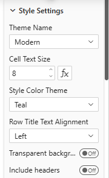

:::info[Settings Location]
These settings live in the **Table Format settings** card of the SDM Xtended Table format pane, in the **Style Settings** group: **Theme Name**, **Cell Text Size**, **Style Color Theme**, **Row Title Text Alignment**, **Transparent background**, **Include headers**.
:::

---

## Overview

Table Styles provide professionally-designed themes that combine fonts, colors, and layouts into cohesive visual designs. Choose a theme and optionally adjust the color palette.

---

## Style Themes

### Available Themes

| Theme | Best For | Vibe |
|-------|----------|------|
| **Custom** | Full control, brand matching | Professional, any style |
| **Modern** | Contemporary reports, dashboards | Clean, minimalist |
| **Classic** | Traditional business reporting | Formal, professional |
| **Scientific** | Research, data analysis | Academic, precise |
| **Market Research** | Survey data, consumer insights | Friendly, accessible |

### Theme Selection
**Setting**: Theme Name  
**Type**: Dropdown  
**Default**: Custom  
**Options**: Custom, Modern, Classic, Scientific, Market Research

---

## Color Themes

Apply a color palette to your chosen style theme with **Style Color Theme** (default: **Monochrome**). These coordinate colors work together for professional, harmonious designs.

### Available Color Themes

| Name            | Best-For                                 | Palette                         | Use case                                       |
|-----------------|------------------------------------------|---------------------------------|------------------------------------------------|
| Monochrome  | Formal, professional, print-friendly     | Shades of single color          | Executive reports, serious tone                |
| Blue           | Corporate, trust, technology             | Navy, sky blue, light blue      | Business reports, finance, tech companies      |
| Green           | Growth, health, environmental            | Forest green, lime, sage        | Healthcare, environmental data, growth metrics |
| Red             | Warnings, performance issues, passion    | Burgundy, coral, crimson        | Risk analysis, sales targets, urgent data      |
| Yellow          | Optimism, caution, energy                | Gold, amber, mustard            | Warnings, positive news, energetic tone        |
| Purple          | Premium, creative, luxury                | Royal purple, lavender, plum    | Premium products, creative industries          |
| Purple Soft     | Modern, approachable, creative           | Soft mauve, light purple        | Modern startups, creative teams                |
| Teal            | Fresh, modern, balanced                  | Teal, turquoise, cyan           | Tech, modern reports, balanced design          |
| Pink            | Contemporary, consumer, friendly         | Rose, coral pink, mauve         | Consumer products, modern reports              |
| Indigo          | Deep, sophisticated, tech                | Indigo, deep blue, violet       | Technical reports, sophisticated design        |
| Sunset          | Warm, approachable, creative             | Orange, pink, gold              | Creative industries, positive reports          |
| Ocean            | Cool, calm, professional                 | Blues and teals, ocean-inspired | Aquatic/marine topics, calming reports         |
| Forest          | Natural, organic, sustainable            | Greens, browns, earth tones     | Environmental, sustainable business            |
| Gold                | Luxury, premium, formal                  | Gold, dark blue, cream          | Premium products, formal events                |
| Light              | Clean, minimal, modern                   | Whites, light grays, accent color| Most business reports, web-friendly           |
| Snow | Ultra-clean, minimal | Pure white header background, dark gray text | Reports where even Light's light-gray header feels too heavy |
| Dark                | Night mode, tech, modern dashboards      | Darks, lights for contrast      | Dark dashboards, night viewing                 |
| Colorful        | Engaging, playful, diverse               | Multi-color rainbow             | Engaging reports, diverse categories           |
| Earth Bound | Warm, grounded, natural | Earth-toned palette | Natural, editorial or sustainability-flavored reports |
| Slate           | Professional, sophisticated, neutral     | Grays, dark grays, blue-grays   | Professional reports, neutral tone             |
| Power BI        | Power BI Standard, consistency           | Power BI brand colors           | Power BI native reports                        |
| Power BI Pro    | Power BI Premium, modern                 | Power BI Premium theme colors   | Premium Power BI environments                  |

### Color theme gallery

Each table below uses **Theme Name: Modern** with a different **Style Color Theme**.

<table>
<tr><td>

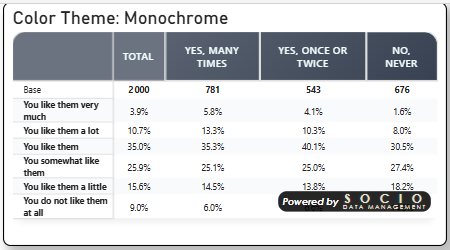

</td><td>

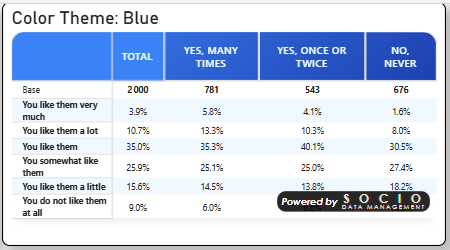

</td><td>

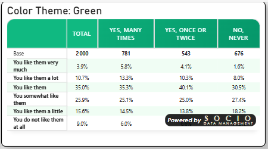

</td></tr>
<tr><td>

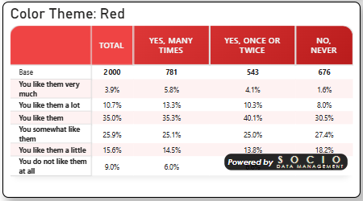

</td><td>

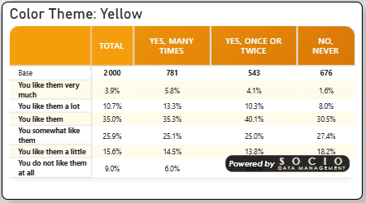

</td><td>

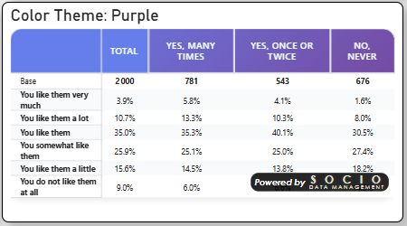

</td></tr>
<tr><td>

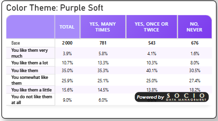

</td><td>

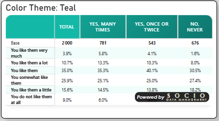

</td><td>

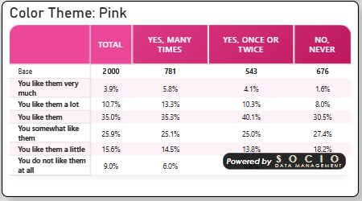

</td></tr>
<tr><td>

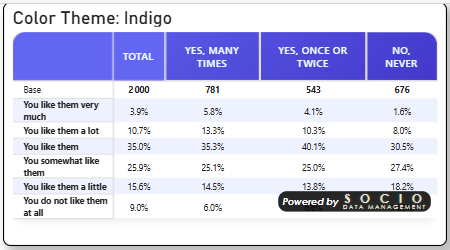

</td><td>

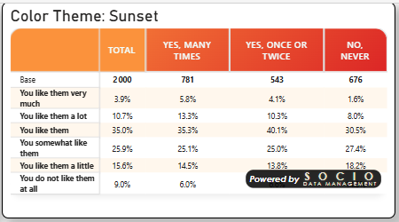

</td><td>

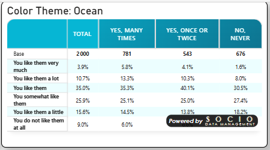

</td></tr>
<tr><td>

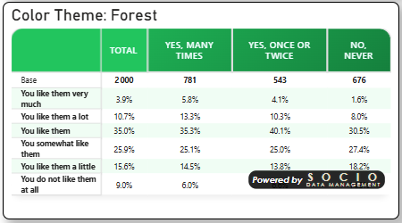

</td><td>

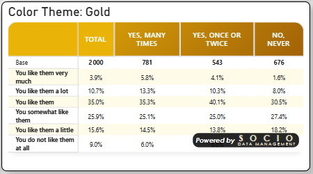

</td><td>

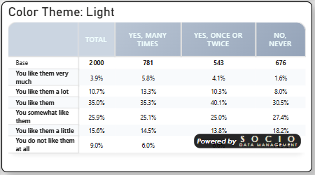

</td></tr>
<tr><td>

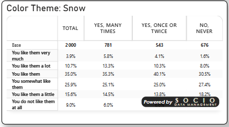

</td><td>

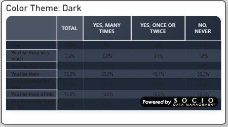

</td><td>

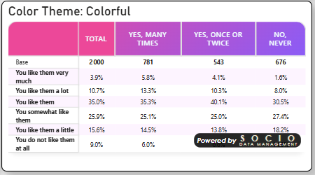

</td></tr>
<tr><td>

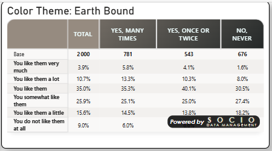

</td><td>

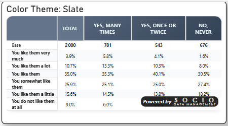

</td><td>

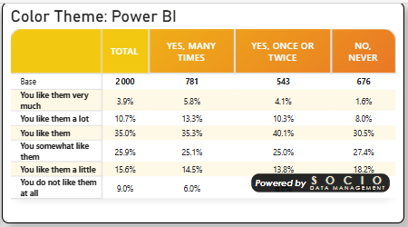

</td></tr>
<tr><td>

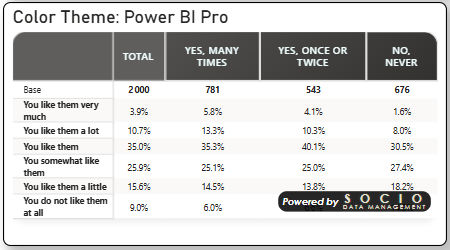

</td></tr>
</table>

---

## Cell Text Size

### Cell Text Size
**Setting**: Cell Text Size  
**Type**: Number (typically 8-14 pt)  
**Default**: 10

Controls the font size of data in table cells.

**Common sizes**:

| Size | Use Case | Readability |
|------|----------|-------------|
| 8-9pt | Dense data, many columns | Dense but readable |
| 10-11pt | Standard business reports | Good balance |
| 12-14pt | Executive summaries, dashboards | Large and clear |
| 15pt+ | Large format displays, presentations | Very large |

**Tips**:
- Headers are typically 1-2pt larger than cells
- Consider your audience (executives prefer larger)
- Test on the device where users will view it
- Smaller fonts allow more data visible at once
- Larger fonts improve accessibility

---

## Transparent Background

### Transparent background
**Setting**: Transparent background  
**Type**: Toggle  
**Default**: Off

Makes the table background transparent (cells, theme card and shadow) so the report canvas shows through the visual. Significance, ranking and conditional-rule backgrounds are kept.

### Include headers
**Setting**: Include headers  
**Type**: Toggle  
**Default**: Off

With *Transparent background* on, also makes the row and column headers transparent. By default headers stay opaque so frozen headers remain readable while scrolling.

:::note
Header levels with a **Custom** background in the [Table Headers](../table-headers.md) editors keep their own color.
:::

---

## Row Title Alignment

### Row Title Text Alignment
**Setting**: Row Title Text Alignment  
**Type**: Dropdown  
**Options**: Left, Center, Right  
**Default**: Left

Controls how row labels (left column) are aligned horizontally.

**Options**:

| Alignment | Example | Best For |
|-----------|---------|----------|
| **Left** | 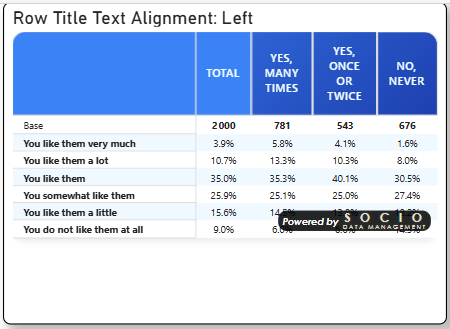 | Standard, most readable |
| **Center** | 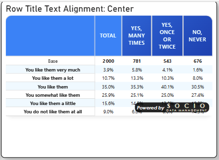 | Formal, numbers-like appearance |
| **Right** | 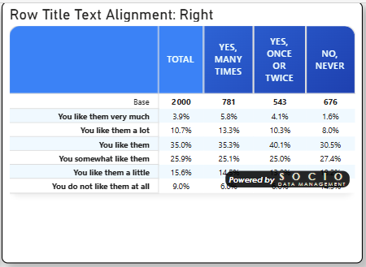 | Technical, numeric labels |

---

## Theme Combinations

Popular pre-configured combinations:

### Professional (Recommended for most)
- Theme: Modern
- Color: Blue or Slate
- Cell text: 10-11pt
- Row align: Left

**Result**: Clean, professional, trustworthy

### Formal/Executive
- Theme: Classic
- Color: Monochrome or Gold
- Cell text: 11-12pt
- Row align: Center

**Result**: Formal, traditional, authoritative

### Academic/Scientific
- Theme: Scientific
- Color: Monochrome or Slate
- Cell text: 10pt
- Row align: Left

**Result**: Precise, objective, academic

### Modern/Tech
- Theme: Modern
- Color: Teal, Indigo, or Dark
- Cell text: 10-11pt
- Row align: Left

**Result**: Contemporary, innovative, tech-forward

### Friendly/Market Research
- Theme: Market Research
- Color: Green, Sunset, or Colorful
- Cell text: 11pt
- Row align: Left

**Result**: Approachable, engaging, accessible

### Sustainable/Environmental
- Theme: Modern
- Color: Forest or Green
- Cell text: 11pt
- Row align: Left

**Result**: Natural, responsible, growth-focused

---

## Custom Theme

When "Custom" is selected, you have full control to match any brand or preference.

Refer to [Custom Element Formatting](./formatting-custom.md) for detailed font and color settings.

**Best for**:
- Brand matching (company colors)
- Non-standard designs
- Accessibility requirements
- Experimental layouts

:::note[Extending Custom Theme]
To fully customize fonts and colors per element, combine Custom style with the *Cell format* card (data cells) and the per-level [Table Headers](../table-headers.md) editors (column and row headers).
:::

---

## Theme Application

Themes are applied in this order (later overrides earlier):
1. Style Theme (base)
2. Color Theme (palette)
3. Cell text size
4. Row alignment
5. Custom Element Formatting and per-level Table Headers (if applied)

---

## Best Practices

1. **Start with a Theme**: Don't start with Custom - choose a theme that's close
2. **Consistent Palettes**: Theme colors are designed to work together - use them
3. **Test Your Audience**: Show sample tables to your audience before finalizing
4. **Light vs. Dark**: Choose Light for printed reports, Dark for digital dashboards
5. **Accessibility**: Avoid low-contrast combinations (e.g., Yellow with Light)
6. **Brand Alignment**: If using Custom, ensure it matches your brand guidelines

---

## When to Adjust Further

Use **Custom Element Formatting** if you need to:
- Change fonts per element (headers vs. cells)
- Style each header level differently (see [Table Headers](../table-headers.md))
- Fine-tune specific colors
- Add bold/italic to headers
- Match exact brand color codes

---

## Examples by Industry

### Finance/Banking
- Theme: Classic
- Color: Monochrome or Blue
- Text: 10-11pt
- Alignment: Left

### Tech/SaaS
- Theme: Modern
- Color: Indigo or Dark
- Text: 11pt
- Alignment: Left

### Healthcare
- Theme: Modern
- Color: Blue or Green
- Text: 11pt
- Alignment: Left

### Retail/E-commerce
- Theme: Market Research
- Color: Colorful or Sunset
- Text: 11pt
- Alignment: Left

### Education/Research
- Theme: Scientific
- Color: Monochrome or Blue
- Text: 10pt
- Alignment: Left

### Non-profit/NGO
- Theme: Modern
- Color: Green or Teal
- Text: 11pt
- Alignment: Left

---

## Troubleshooting

**Q: My theme doesn't match my brand**  
A: Use Custom theme, then add Custom Element Formatting for full control

**Q: Color theme looks washed out**  
A: Try a darker color theme (Dark, Slate, Indigo instead of Light)

**Q: Text is hard to read**  
A: Increase Cell Text Size or switch to high-contrast theme (e.g., Dark)

**Q: Printing looks different**  
A: Print preview may show colors differently; test print before finalizing

---

## Related Topics

- [Table Options](./formatting-basics.md) - Display behavior settings
- [Custom Element Formatting](./formatting-custom.md) - Fine-tune individual elements
- [Formatting Overview](./index.md) - All formatting options

Socio Data Management - All rights reserved
