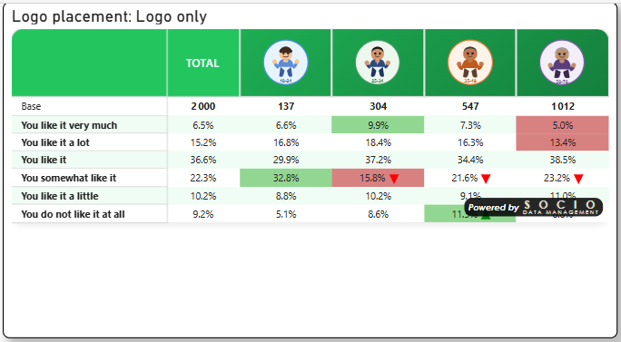
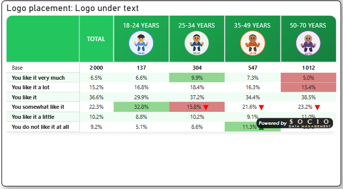
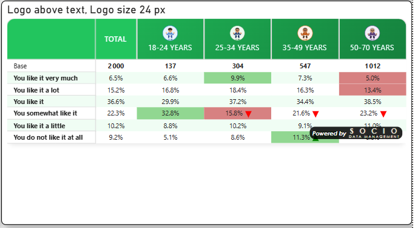

Socio Data Management - All rights reserved

# Logos in Headers Reference

:::info[A different mechanism from CrossTable]
CrossTable binds logos through fixed data roles (`colLogoLv1`…`rowLogoLv2`) and a dedicated **Logos** card, capped at three column levels and two row levels. **SDM Xtended Table** has **neither the roles nor the card**: logos are configured from the **Table Headers** card, with no limit on the number of levels.
:::

## Overview

Logos let you display **images inside row and column headers** — for example company or brand logos in a competitor comparison, or product icons in a key-account table. In SDM Xtended Table, every row level and every column level can show a logo, whatever the depth of your hierarchy.

There are two ways to feed a logo to a header level, both set up from the icons shown at the top-right of the visual in Edit view (their settings are stored in the **Table Headers** card):

| Way | When to use it | Cost |
|---|---|---|
| **Header Logos lookup** (🖼️ Header Logos editor, `headerLogoLookup`) | The logo depends only on the header **label** (a brand, a country…). You map an exact label to a base64 image once, in the editor. | None: resolved entirely inside the visual, no query cost. **Preferred.** |
| **Logo series** (a measure in the **Additional Series** field well, picked per level in the Column / Row editor) | The logo comes from your data model, as a DAX measure returning a base64 image, constant per category. | One extra measure evaluated per matrix cell, which can be heavy on large tables. |

:::info[No external URLs]
Logos are provided as **base64 data URIs**, never as an external URL. Every image is passed through `sanitizeImageDataUri` before being rendered, keeping the visual certification-safe.
:::

---

## Where to configure them

Everything — which level shows a logo, its size, its display mode, the lookup table and the optional named logo tables — is described on one page:

- **[Table Headers](./table-headers.md)** — the 🏛️ Column editor / 📝 Row editor (per-level logo placement and size), the 🖼️ **Header Logos** lookup editor, named logo tables and the Logo series.

For a step-by-step walkthrough, see the logos tutorial in the same section.

### Placement and size

Each level block of the Column / Row editor has a **Logo placement** field (*Logo only*, *Logo above text* — the default —, *Logo under text*) and a **Logo size (px)** field (8–100, default 24).

---

## Coming from CrossTable

| CrossTable | SDM Xtended Table |
|---|---|
| `colLogoLv1/2/3`, `rowLogoLv1/2` data roles | Removed. Use the Header Logos lookup, or the `additionalTable` role for a Logo series |
| **Logos** card (`Show logos`, size and mode per level) | Removed. Size and placement are fields of the per-level Column editor (🏛️) / Row editor (📝) |
| Max 3 column levels / 2 row levels | No cap |

A CrossTable report is **not migrated automatically**: SDM Xtended Table is a separate visual, so logos must be set up again with the mechanisms above.

---

## Security & certification

Every logo goes through `sanitizeImageDataUri` before reaching the DOM: only well-formed `data:image/...;base64,` URIs of an allowed image type are rendered; anything else is silently dropped. The visual never fetches an image from the network.

## Related

- [Table Headers](./table-headers.md)
- [Formatting](./formating/index.md)

Socio Data Management - All rights reserved
