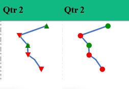
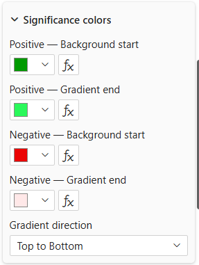
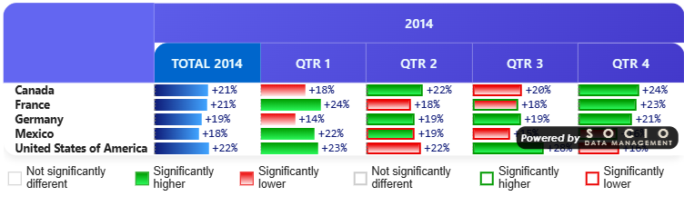
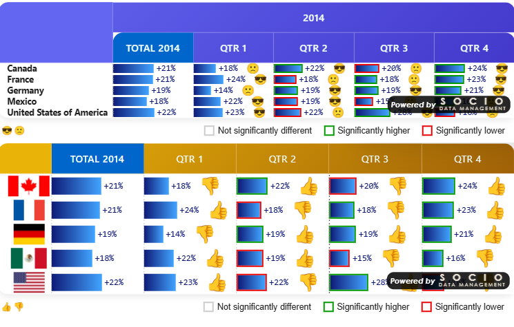

# Significance on Charts

Significance **tests** — what is compared, at what confidence level, with which variance method — are configured exactly the same way as in CrossTable. See [Significance Testing](../04-reference/significance.md) for the full reference (test types, confidence levels, regex targeting, legend). This page only covers what's **different** when the test result decorates a chart (Data Bar / Data Line) instead of a plain table cell.

---

## No "All Columns" (lettered) testing

CrossTable's **All Columns** test type marks each cell with a **letter** (A, B, C…) identifying *which other specific column* it is significantly different from. That only makes sense next to a printed number — there is nowhere to put a legible letter on a 10px-tall bar.

CrossTable InCell Charts therefore only offers:

| Test type | Available |
|---|:---:|
| None | ✅ |
| All columns *(lettered)* | ❌ |
| Item vs question item | ✅ |
| Item versus Total (Base) | ✅ |
| Regular expression | ✅ |
| Previous visible column | ✅ |
| Previous row | ✅ |
| Partition Gap *(Gap Mode only)* | ✅ |

All the remaining test types produce a simple **verdict per cell** — higher (+1), lower (−1), or not significant (0) — which is exactly what a chart overlay needs.

:::note[Partition Gap is exclusive to Gap Mode]
**Partition Gap** doesn't exist as a general-purpose test — it doesn't compute anything outside of [Gap Mode](gap-mode.md), where it drives the **Gap vs 2nd**/**Gap vs 3rd** columns specifically (main partition vs. the named competitor). Picking it for a significance slot while Gap Mode is off, or while neither gap column is shown, simply does nothing. See [Gap Mode → Significance drives color](gap-mode.md#significance-drives-color-the-scale-is-computed-per-column) for the full picture of which test decorates which gap column.
:::

---

## Variance method and effective base

The **Signif. Var. Method** setting of the Significance card also offers **Separate (effective base)** here, on top of *Pooled proportion* and *Separate* (percentage tables only):

`t = (P1 − P2) / √( P1(1−P1)/EffBase1 + P2(1−P2)/EffBase2 )`

P1 and P2 still come from your values and base series; only the variance uses the **effective base** — typically the raw N × the design effect, so it is smaller than the weighted base on a weighted sample.

**Choosing this method opens one more slot in the Series usage card: "Effective Base Series".** Map it to a measure returning the effective base of each cell (leave it on *None* and each cell falls back to its raw base). The sub-totals and column totals of that series follow the same rules as the weighted base — summed or not according to [Sample Across Items](sample-across-items.md).

One method for all tests: **Significance level** and **Signif. Var. Method** apply to every active significance test (1, 2, 3) *and* to the Partition Gap test of [Gap Mode](gap-mode.md), so a gap is never tested with a different formula from the verdicts next to it.

---

## The chart overlay

Instead of coloring table cell backgrounds/borders and printing letters, each active, **significant** test applies its configured **view** as a chart decoration:

| View | Effect on Data Bar | Effect on Data Line |
|---|---|---|
| **Font color** | Colors the numeric label next to the bar. | *(no label to color — no effect)* |
| **Background color** | Colors the bar's fill — solid, or a gradient if a *Gradient end* color is set for that sign (see [Significance colors](#significance-colors--gradients) below). | *(no fill to color — no effect)* |
| **Marker** | A colored shape (circle / square / diamond / triangle — see [Legend](../04-reference/significance.md#significance-legend)) at the bar's tip. | A colored shape at the data point. |
| **Icon** | The default green/red triangle, or your custom base64 icon, at the bar's tip. | The default/custom icon at the data point. |
| **Border color** | *(not used — border is reserved for CrossTable's plain cell rendering)* | *(not used)* |

Configure the view **per test** (Significance 1 / 2 / 3 each have their own **Significance view option**), exactly as in CrossTable.

📸 **Screenshot — rendered result** `sigcharts-overlay-databar-views.png` — the same significant Data Bar cell shown 4 times, one per usable view (Font color, Background color, Marker, Icon), for side-by-side comparison.

:::note[Gap Mode is the one exception]
This table describes an ordinary Data Bar/Data Line cell. [Gap Mode](gap-mode.md) cells are a genuine cell (not a bare chart mark), so **Border color** *does* work there — see [Gap Mode → Bar vs. Number](gap-mode.md#significance-drives-color-the-scale-is-computed-per-column).
:::

### When several tests are significant on the same cell

- **Font color** and **Background color** are single values — if more than one active test requests them on the same cell, the **first** matching test (1, then 2, then 3) wins.
- **Marker** and **Icon** **stack** — you can see, for example, test 1's icon *and* test 2's marker on the same bar tip at once.

📸 **Screenshot — rendered result** `sigcharts-stacking-example.png` — a bar tip showing two decorations at once: one test's icon and another test's marker, stacked.

---

## Significance colors & gradients

**Location**: Format pane → **Significance** card → **Significance colors** group *(shared with CrossTable)*.

| Setting | Description |
|---|---|
| **Positive — Background start** | Override color for a significantly-higher verdict. Feeds both the table's cell background (in CrossTable) and the chart's Background/Font views (here). Leave empty to use the style theme's default. |
| **Positive — Gradient end** | If set, the Background view becomes a gradient from *Background start* to this color instead of a solid fill. |
| **Negative — Background start** / **Negative — Gradient end** | Same, for a significantly-lower verdict. |
| **Gradient direction** | 6 directions (Top↔Bottom, Left↔Right, both diagonals) — applies to the significance gradient specifically, independent of Data Bar's own axis-to-tip gradient direction (see [Data Bar Colors](data-bar.md#colors)). |

:::tip[Two different gradients, don't confuse them]
Data Bar's **Positive/Negative from/to** (in the *Data Bar* card) color the bar based on its **sign**, regardless of significance. Significance's **Background start/Gradient end** (in the *Significance* card) color it based on a **test's verdict**, and only take effect when *Bar value* is set to a *Follow Signif Rule* and that test's view is *Background color*. When both could apply, the significance colors win — see [Data Bar Colors](data-bar.md#colors).
:::

---

## Marker shapes & custom icons

- **Marker shape** — Circle, Square, Diamond or Triangle, set per test (Significance 1 / 2 / 3), used when that test's view is **Marker**.
- **Custom icon (base64)** — replace the default green/red triangle with your own image, set per test and per direction (**Custom icon positive**, **Custom icon negative**), used when that test's view is **Icon**.

📸 **Screenshot — rendered result** `sigcharts-markershapes-montage.png` — the four marker shapes (Circle, Square, Diamond, Triangle) compared side by side on otherwise identical bars.

---

## Legend

The [significance legend](../04-reference/significance.md#significance-legend) (labels, suffixes, font) works identically and can be shown under the table regardless of whether the underlying cells are plain numbers or charts.

**Position** (`legendPosition`) · **Options**: Top, Bottom · **Default**: Bottom — CrossTable InCell Charts-only addition. Moves the whole legend above or below the table; its own left/center/right layout (centered with one active test, spread left/right with two or three — see [Significance Legend → Layout](../04-reference/significance.md#layout)) is unchanged. Independent from the [Data Bar/Data Line series legend's Position](data-bar.md#legend), which additionally offers left/center/right control — the two legends can be placed on opposite sides of the table so they never compete for space.

📸 **Screenshot — rendered result** `sigcharts-legend-top.png` — the significance legend shown above the table (**Position**: Top).
📸 **Screenshot — rendered result** `sigcharts-legend-bottom.png` *(optional)* — the same legend shown below the table (**Position**: Bottom, the default).

---

## Grouped charts

The overlay described on this page decorates **individual** Data Bar/Data Line elements. When [Group into one chart](data-bar.md#grouping) is active, grouped series bars/points use their series color only — the significance overlay does not currently apply in grouped mode.
