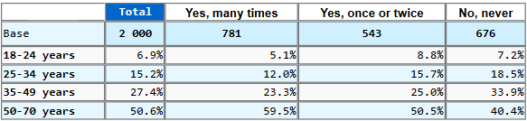
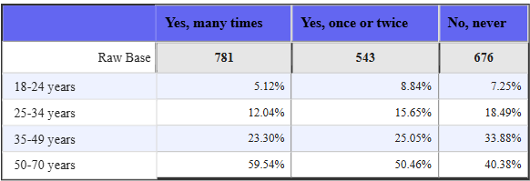
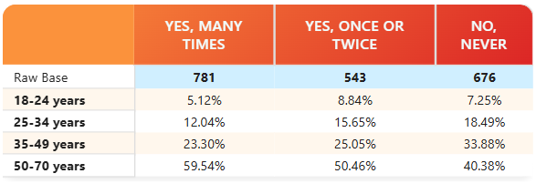
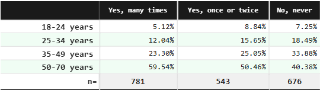
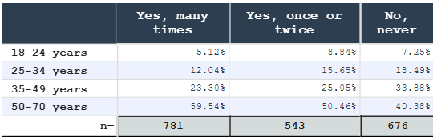
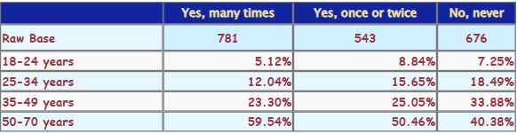

# Quick Start Guide

## 5-Minute Overview

Get SDM Xtended Table up and running in just a few minutes with this quick walkthrough.

<video autoPlay loop muted playsInline style={{ maxWidth: "100%", border: "1px solid #ccc", borderRadius: "4px" }}>
  <source src="/sdmpbitable-docs/videos/quickstart.webm" type="video/webm" />
</video>
[Quick Start Video](/videos/quickstart.webm)

### Step 1: Add the Visual

1. In Power BI Desktop, create a **new blank report**
2. Go to **Visualizations** pane on the right
3. Click the **three dots** and select **Get more visuals**
4. Search for and add **SDM Xtended Table**

### Step 2: Prepare Your Data

SDM Xtended Table needs at least:
- **Row field(s)**: Categories for table rows — as many levels as you need
- **Column field(s)**: Categories for table columns — as many levels as you need
- **Value field**: Numerical data (usually for mean table) or any categorical variable or measure (usually for percentage table).

:::info
**Tip:** You do not need to prepare specific measure, unless you need to **weigth** your data. For percentage tables, you can use any categorical field (e.g., Product, Region, Gender, Age class, Segment...) or a measure that returns categorical data. For mean tables, use numerical fields (e.g., Sales, Revenue, Age).
:::

**Example dataset:**

Product      | Region   | Sales
-------------|----------|--------
Product A    | North    | 15,000
Product A    | South    | 12,000
Product B    | North    | 18,000
Product B    | South    | 14,000

With this dataset you can create:
- a cross-tab showing sales distribution of products across regions, in this case, drop any of "Product" or "Region" column in the "value" field and select "Count" measure in the "Values" field.
- a mean table showing average sales per product and region, in this case, drop "Sales" column in the "value" field and select "Average" measure in the "Values" field.

### Step 3: Create Your First Table

1. Add the **SDM Xtended Table** visual to your report canvas
2. In the **Visualizations** pane:
   - Drag one or more fields to **Rows** (e.g., "Product"); each extra field adds a row level
   - Drag one or more fields to **Columns** (e.g., "Region"); each extra field adds a column level
   - Drag a measure to **Values** (e.g., "Sales"), select 'count' for percentage or 'average' for mean table.
   - Select the appropriate table type in Visual properties

3. Your table appears!

### Step 4: Basic Configuration

In the format panel, you can immediately:

- **Table Type**: Switch between "Percentage" or "Mean"
- **Show Measure**: Toggle **Value, vertical/horizontal percentages, indice** buttons
- **Select series usage**: Configure multiple value series (e.g., count, mean, std. dev., base, unweighted base...)
- **Show Totals**: Add row and column totals, and sub-totals level by level
- **Table Headers**: Open the ⚙ **Column Headers** / **Row Headers** editors to format each level (see [Table Headers](../04-reference/table-headers.md))
- **Formatting**: Change theme, fonts and colors

The default format is a 'custom' basic simple table format:

With two click, you can change to other pre-defined styles and color theme like:

- _Classic Indigo:_  

- _Modern Sunset:_  

- _Market Research Forest:_  

- _Scientific Indigo:_  

- _Or customize your own style:_  

#### See [Styling Your Table](../04-reference/formating/index.md) for more details.

---

## Common Configurations

### Configuration A: Percentage Analysis

Best for survey data, response rates, market share

1. Set **Table Type** → "Percentage"
2. Check **Vertical percentage** (% within each column)
3. Check **Show total column**
4. Enable **Zebra rows** for readability

### Configuration B: Mean Analysis

Best for averages, performance metrics

1. Set **Table Type** → "Mean"
2. Configure **Mean Series** in data properties
3. Add **Count Series** for sample size
4. Optional: Add **Standard Deviation** for analysis

### Configuration C: Comparison with Significance

Best for highlighting differences in survey data

1. Configure as Percentage Analysis
2. In **Significance settings**:
   - Set **Significance 1** to "All columns" or "Item vs other"
   - Set **Significance Level** to "95%"
   - Select **Font Color** for display
3. Significant differences appear highlighted

### Configuration D: A battery of items answered by the same people

Best for brand grids or any list of items rated by the **same** respondents

1. Put the items on the last level of your columns (or rows)
2. In the ⚙ header editor of that level, set **Sample across items** to "Shared" (or "Native" if your model provides the sub-total measure)
3. Totals then use the real sample size instead of adding the bases of every item (and, with **Shared** or **Native**, so do the significance tests against the rest of the row) — see [Sample Across Items](../04-reference/sample-across-items.md)

---

## Next Steps

### To Learn More:
- [Explore table features](explore-table-features.md) — Detailed step-by-step
- [Feature Reference](../04-reference/table-content.md) — All available options
- [Use Cases](../03-use-cases/business-cases.md) — Real-world examples

### To Customize:
- [Complete Reference Guide](../04-reference/table-content.md) — All settings explained
- Specific guides:
  - [Table Contents](../04-reference/table-content.md)
  - [Sorting Options](../04-reference/sorting.md)
  - [Ranking & Visualization](../04-reference/ranking.md)

---

## Keyboard Shortcuts (Power BI)

- **Ctrl+Shift+F5**: Refresh visuals
- **Click + Drag**: Interact with table (if enabled)
- **Export**: Use Power BI's Export option

---

## Common Questions

**Q: My data doesn't appear in the table**  
A: Check that you've assigned values to Rows, Columns, and at least one Value field.

**Q: Can I show multiple metrics?**  
A: Yes! Drag multiple measures to Values and configure series in settings.

**Q: How do I add hierarchies?**  
A: Drag multiple fields to Rows or Columns to create hierarchical levels. There is no fixed limit on the number of levels; format each one from the Table Headers editors.

**Q: Is there a data limit?**  
A: SDM Xtended Table follows Power BI's native limits (~1M rows visual-level).

---

Ready to go deeper? Check out the [complete reference guide](../04-reference/table-content.md) or explore [real-world use cases](../03-use-cases/business-cases.md)!
