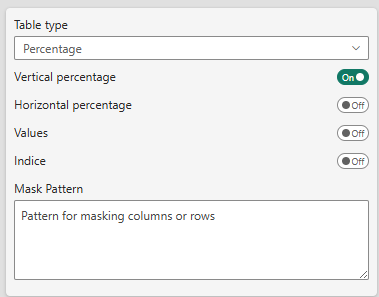
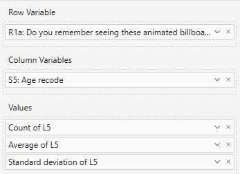
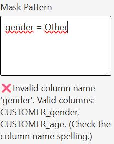

# 'Table Contents' settings Reference

## Overview


:::tip[The **Table Contents** section controls what data is displayed in your table and how it's aggregated.]
:::

## Table Type

**Setting**: Table type (Percentage or Mean)  
**Default**: Percentage

### Percentage Tables

Used to analyze distributions, proportions, and response rates.

**Available Displays**:
- **Values**: Raw count or sum
- **Vertical Percentage (%)**: Percentage within each column
- **Horizontal Percentage (%)**: Percentage within each row
- **Cell Percentage (%)**: Each cell's value divided by its own base (alternative to the vertical percentage)
- **Indice**: Index value (typically 100 = average)

**Example**: In a survey of 100 respondents:
```
            Very Satisfied    Satisfied    Neutral
North       45 (60%)         30 (40%)     25 (33%)
South       35 (47%)         45 (60%)     45 (60%)
Total       80 (53%)         75 (50%)     70 (47%)
```

### Mean Tables

Used to analyze averages and their statistical properties.

**Available Displays**:
- **Mean Values**: Average of the metric
- **Count**: Number of observations used in calculation
- **Standard Deviation**: Measure of variability
- **Indice**: Index based on mean values

**Example**: Average customer satisfaction score:




## Display Options

### Values
**Label**: Show values  
**Type**: Toggle  
**Default**: Off

When enabled, displays the raw count or sum in each cell.

### Vertical Percentage
**Label**: Vertical percentage  
**Type**: Toggle  
**Default**: On

Shows each cell's value as a percentage of its column total. Useful for comparing across categories within groups.

### Horizontal Percentage
**Label**: Horizontal percentage  
**Type**: Toggle  
**Default**: Off

Shows each cell's value as a percentage of its row total. Useful for comparing category distribution within segments.

### Cell Percentage
**Label**: Cell percentage  
**Type**: Toggle  
**Default**: Off

Shows each cell's value divided by **its own base**, read directly from the Base Series at that crossing:

```
Cell Percentage = Value (row × column) / Base (row × column)
```

**How it differs from the vertical percentage**: the vertical percentage divides by the **column total** of the Base Series, which the visual builds by going through the rows. Cell Percentage only looks at the current crossing. Use it when your model already provides the right denominator for every cell, for example a base that varies from one row to the next (items asked to different sub-samples, a rating scale with a per-item base, a "value + its base" pair computed in DAX).

**Example**:
```
                   Value    Base (per cell)    Cell %
Brand A / North     120          300           40%
Brand B / North      90          150           60%   ← asked only to half the sample
```
With the vertical percentage, both rows would be divided by the same column total.

**Subtotals and totals**: on a group row or column, value and base are both summed over the children, and the ratio of the two sums is shown. No extra setting is needed.

**Mutually exclusive with Vertical Percentage**: both use the same slot in the cell and act as the table's main percentage, so turning one on turns the other off automatically.

**It replaces the vertical percentage everywhere downstream**, not just in the display:
- **Significance tests**: the proportion tested is the Cell Percentage, and the sample size is the cell's own base instead of the column total. The same data can therefore give a different verdict depending on which percentage is selected. See [Significance Testing](significance.md#series-configuration-for-testing).
- **Sorting and ranking**: *Cell Percentage* becomes available as a [Column Property](sorting.md#column-property) and a [Ranking](ranking.md) cell value.
- **Tooltip**: a separate *Cell %* line can be shown, see [Tooltip](tooltip.md).
- **Cell rules**: available as the `cellPct` variable, see [Cell Rules](cell-rules.md).
- **Excel export**: exported in place of the vertical percentage.

:::note
Cell Percentage only applies to **percentage** tables. It is left empty on mean tables.
:::

### Indice
**Label**: Show indice  
**Type**: Toggle  
**Default**: Off

Displays index values (typically with 100 as base). Useful for comparing relative performance against an average.

**Calculation**: `(Cell Value / Average) × 100`

---

## Empty Datasets

When the incoming dataset contains **no rows** — most commonly when a page or report filter excludes everything — the table is never drawn (no empty "shell" made of a column header and a `Base` row at 0), and the Excel export button is hidden whatever the *Show Excel Export Button* setting says, since there would be nothing to export.

What the visual shows instead — a message you style yourself, or nothing at all — is controlled by the **Global Threshold** card. That card also hides the table on a test of your own (a base below your publication threshold, say): see [Global Threshold](global-threshold.md).

:::info[*Clear on Empty dataset* has been replaced]
The toggle that used to live here only chose between a hard-coded *"No data to display"* message and a blank screen. It is gone, replaced by the Global Threshold card — its **Empty Panel** property has the opposite polarity, and the old value is not carried over. See [Coming from *Clear on Empty dataset*](global-threshold.md#coming-from-clear-on-empty-dataset).
:::

---

## Masking

:::info[WHY USE MASKING WHEN POWER BI CAN FILTER DATA?]
When you filter data in Power BI, the underlying data is removed from the visual, which can affect calculations like totals and percentages. Masking allows you to hide specific data points **while still including them in calculations**, ensuring accurate results.
:::

---

### Mask Pattern
**Label**: Mask Pattern  
**Type**: Text area  
**Default**: Empty  

Allows you to mask (hide) data from specific rows or columns using regular expressions.



User will input a pattern to match the rows/columns to be hidden. As an example, if you want to show ONLY Brand A and Brand B, you need to hide everything which is NOT Brand A or B.

```text
Label_Brand != BrandA AND Label_Brand != BrandB
```

or better with the IN operator


```text
NOT Label_Brand IN (BrandA, BrandB)
```

Therefore, if also you do not want the "No answer" to gender question while still using it in calculations:
```
(NOT Label_Brand IN (BrandA, BrandB)) OR Customer_Gender = "Not Stated"
```

etc ...
```text
(NOT Label_Brand IN (BrandA, BrandB)) OR (Customer_Gender IN ("Not Stated", Other))
```

:::caution[Beware of the inverted logic of masking.]
The pattern defines what to HIDE, this can be somewaht counter-intuitive at first.
:::

Valid operators are:
- IN - for multiple values
- AND - for logical conjunction
- OR - for logical disjunction
- NOT - for negation
- = - Equals
- != - Not equals
- \< - Less than
- \> - Greater than
- LIKE - Pattern matching with % wildcard

:::tip[\<= and \>= does not exist]
if you want to filter for years greater than or equal to 2020, you need to use `Year > 2019`
:::

The __*LIKE*__ operator works with the % symbol, for example:
```text
Customer_Gender LIKE %ale
```
Will hide M'ale' AND Fem'ale', and therefore show only "Not Stated" and "Other"

To show only Male **AND** Female, you need to invert the logic:
```NOT Customer_Gender LIKE %ale```

Will show ONLY Male and Female

:::tip[Blank / empty values]
If a category has no value in your data (Power BI shows it as blank), it appears as an **empty label** in the table — not the word "Null". A pattern like `Label_Brand = Null` will therefore never match it.

To target blank values specifically, compare against an empty string:
```text
Label_Brand = ""
```

To exclude blanks while keeping everything else, use the greater-than operator:
```text
Label_Brand > ""
```
:::

**Use Cases**:
- Hide sensitive data in shared reports
- Remove small brands/categories from view
- Focus on top-performing segments
- Filter out "Other" or "Not answered" categories while still taking them into account for calculations

---

## Series Configuration

For detailed series configuration options (Value Series, Base Series, Mean Series, etc.), see:
- **[Percentage Series Usage](percentage-series.md)** — For percentage tables
- **[Mean Series Usage](mean-series.md)** — For mean tables

---


## Best Practices

1. **Choose Table Type First**: Percentage vs Mean fundamentally changes how data is displayed
2. **Limit Display Fields**: Use 2-3 display options maximum for clarity
3. **Use Masking Sparingly**: Masked data is still calculated but hidden
4. **Precision for Business**: Use 0-1 decimal places for most business reporting
5. **Totals Context**: Show totals to help readers understand the base size

---

## Related Settings

- [Totals Settings](totals.md) — Configure total rows and columns
- [Series Configuration](percentage-series.md) — Detailed data mapping
- [Sorting Options](sorting.md) — Arrange rows and columns

---

## Troubleshooting

**Q: Values appear as "0%" or very small numbers**  
A: Check that your base series is correctly mapped in percentage series settings.

**Q: Indice values don't look right**  
A: Ensure you've configured both values and base series correctly.

**Q: Mask pattern isn't working**  
A: Check your regular expression syntax. Use simple patterns like `Total` before complex regex.

For more help, see the [Quick Start Guide](../02-getting-started/quick-start.md).
