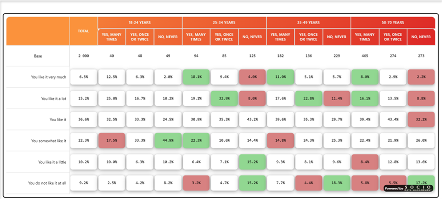
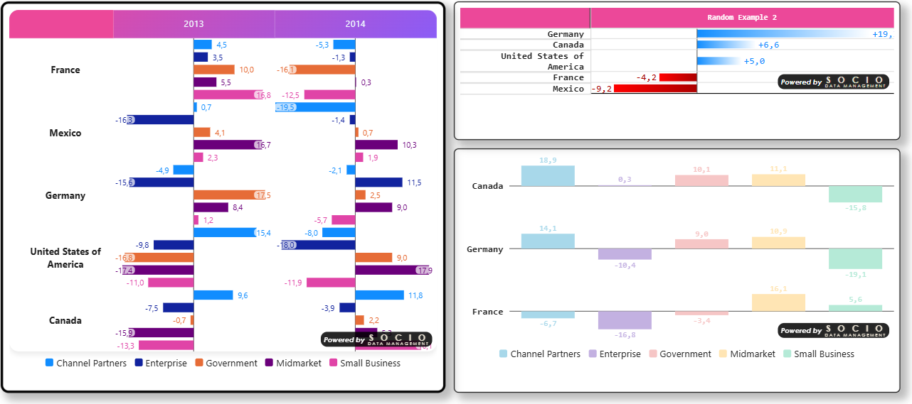
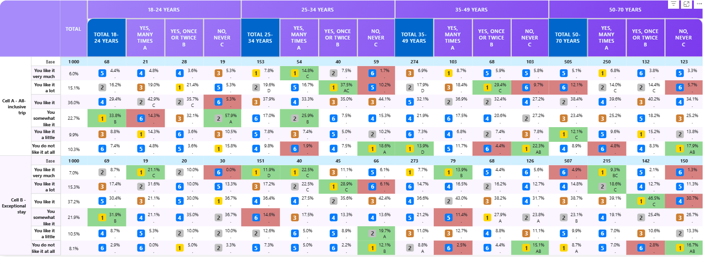

Socio Data Management - All rights reserved

# SDM Table Visuals for Power BI

**Socio Data Management** publishes three complementary cross-tabulation visuals for Power BI. They share the same data roles, the same percentage and mean engine, the same significance tests, totals and thresholds — they differ by how far they go.

| Visual | Choose it when… |
|---|---|
| [**Xtended Table**](./02-xtendedtable/01-introduction/overview.md) | You need a pure table with **any number of row and column levels**, per-level header editors and a per-level sample model. This is the recommended starting point for new reports. |
| [**CrossTable InCell Charts**](./03-crosstable-charts/01-introduction/overview.md) | You want **Data Bars, Data Lines or Gap Mode** drawn directly inside the cells of the table. |
| [**CrossTable (Legacy)**](./04-crosstable-legacy/01-introduction/welcome.md) | You maintain reports built with the original SDM Cross Table Tool (2 levels of rows, 3 levels of columns). |

## Xtended Table

The cross-tab visual with N levels of rows and columns, ⚙ editors for headers and logos, and a Disjoint / Shared / Native sample model set per level.

## CrossTable InCell Charts

The same hierarchical table, with diverging **Data Bars**, connected **Data Lines** and an optional **Gap Mode** replacing plain numbers inside the cells.

## CrossTable (Legacy)

The original visual. It remains supported and documented, in its own section, exactly as before.

## Common Settings

Some cards are strictly identical across the visuals (for instance [Global Threshold](./05-common-settings/global-threshold.md)). They are documented once in the [Common Settings](./05-common-settings/global-threshold.md) section.

## How each section is organized

Each visual has the same four sub-sections: **Introduction**, **Getting Started**, **Use Cases** and **Reference**.

Socio Data Management - All rights reserved
